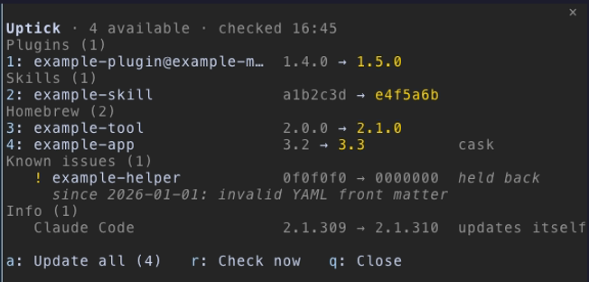
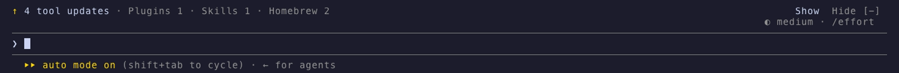

# Uptick

**See what is out of date around Claude Code, and update it after you confirm the exact command.**

[](https://github.com/trustmeimlumi/uptick/actions/workflows/test.yml)
[](LICENSE)
[](#requirements)
[](https://github.com/trustmeimlumi/uptick/releases)


Uptick is a Claude Code mod. `/uptick` opens a pane that lists what has a newer version: Claude Code
itself, your plugins, your skills and your Homebrew packages. Pick one, or press `a` for all, check the
exact command it will run, and confirm. A line above the prompt tells you when updates are waiting.

## Who it's for

You use Claude Code every day, you have plugins from a few marketplaces, skills from GitHub, and tools from
Homebrew, and you would rather not run four different update commands to find out what changed.

## What it checks

| Group | Compared against | Updated with |
|---|---|---|
| Claude Code | the npm registry's latest | nothing: it updates itself; shown under Info |
| Plugins | the version the plugin's marketplace advertises (a plugin in its own GitHub repo: that repo's `plugin.json`) | `claude plugin update <id>` |
| Skills installed with the [skills CLI](https://www.npmjs.com/package/skills) | the skill's folder on GitHub (tree hash) | `npx --yes skills@1.7.4 update -g <id>` |
| Homebrew formulae and casks | `brew outdated`, optionally only what your Brewfile lists | `brew upgrade <id>` (`--cask` for a cask) |
| Your own checks | whatever your command prints | nothing: shown under Info |

A check whose tool is missing is skipped. A plugin whose version is not a version (a git hash, or none
advertised) is listed under Info as `not compared`, never offered.

## Requirements

- **Claude Code on your own computer.** Uptick runs programs on the machine Claude Code runs on, so it works
  only in Claude Code there: not on claude.ai on the web or on mobile, and not in Cowork.
- **Claude Code**: tested with 2.1.309, the version CI pins.
- **Python 3.9 or newer** as `python3` (macOS, Linux) or through the `py` launcher (Windows). The checker
  uses the standard library only.
- Optional, each enabling one check:
  - **npm**: compares Claude Code with the registry, and runs skill updates through `npx`;
  - **gh**, signed in: compares skills, and plugins kept in their own GitHub repo;
  - **Homebrew**: the Homebrew group.

## Where it works

| | Status |
|---|---|
| Terminal (`claude`) | Tested. Everything works. |
| Desktop app | The pane and the line above the prompt draw, but the app's local session runs no slash commands, so `/uptick` does not work there. When the last result has updates, the line above the prompt appears with **Show**, which opens the pane. |
| VS Code extension | Untested. |
| claude.ai (web, mobile) and Cowork | Not supported: the plugin does not install there. |
| macOS | Tested. |
| Linux | The checker's tests run in CI; the mod's tests run there too. No casks on Linux. |
| Windows | The checker's tests and the mod's tests (on the fake engine) run in CI. The mod starts the checker with `py -3` and runs `npx` and `claude` through `cmd.exe /d /c`; this has not run in a real session yet. No Homebrew. |

## Install, update, uninstall

At the prompt of a terminal session:

```
/plugin install uptick --marketplace trustmeimlumi/uptick
```

From a shell, with settings if you want them:

```
claude plugin install uptick --marketplace trustmeimlumi/uptick --config brewfile=~/Brewfile
```

In the desktop app: + next to the prompt box → Plugins → Add marketplace `trustmeimlumi/uptick` → Add plugin.

Update: `claude plugin update uptick@uptick`, then `/reload-plugins`.
Uninstall: `claude plugin uninstall uptick@uptick`.

Uptick keeps two files of its own; uninstalling leaves them, and you can remove them by hand:

- the last result: `${XDG_CACHE_HOME:-~/.cache}/uptick/last.json` (on Windows `%USERPROFILE%\.cache\uptick\last.json`);
- the known-broken list, if you made one: `${XDG_CONFIG_HOME:-~/.config}/uptick/known-broken.json`.

## Using it

`/uptick` opens the pane. It shows the last result at once and checks again in the background.



| Key | Does |
|---|---|
| `1`–`9` | pick an item, numbered on across the groups |
| `a` | update all |
| Tab or Shift+Tab to **Update**, then Enter | run it, in the confirm step (a click works too) |
| `n` | cancel |
| `s` | stop after the current item |
| `r` | check now, fetching marketplace and Homebrew metadata first |
| `l` | after a plugin update: types `/reload-plugins` into the prompt; press Enter to run it |
| `o` / `b` | the full output of a failed update, and back |
| `q` | close |

`ctrl+x tab` gives the pane the keyboard. The confirm step shows the exact command. **Update** has no
hotkey, so nothing you type can start an update; Cancel holds the focus.

When updates are waiting, one line above the prompt says so, with **Show** and **Hide**, also while Claude
works, so you can open the pane mid-turn. Hide keeps it away until the list changes. Other mods' rows there stay where they are.



Under `claude -p "/uptick"` you get a plain-text report and nothing is installed.

## What it runs and sends

**Runs to check, read-only:** the checker, `plugin/checker/check_updates.py`, with `python3` (on Windows,
`py -3`), when the pane opens, when you press Check now, again after each run of confirmed updates, and for
`claude -p "/uptick"`. It asks `claude`,
`npm`, `gh` and `brew` for installed and latest versions, and runs your `checkCommand` if you set one. With
Check now (or `fetchOnOpen`) it first runs `claude plugin marketplace update` per marketplace and
`brew update`.

**Reads:** its cache file, `${XDG_CACHE_HOME:-~/.cache}/uptick/last.json`; your installed plugins' and
skills' metadata (`claude plugin list`, `~/.claude/plugins/known_marketplaces.json` and `marketplaces/`,
`~/.agents/.skill-lock.json`); the Brewfile, if you set one; the known-broken list, yours or the default one
when it exists; and the environment variables `HOME`, `USERPROFILE`, `OS`, `XDG_CACHE_HOME` and
`XDG_CONFIG_HOME`, to find those files.

**Passes on:** each item's name to its update command; your marketplace names to `claude plugin marketplace
update`; the GitHub repositories, folders and refs named in your plugin and skill metadata to `gh api`, which
asks GitHub for them; and the Brewfile path, the known-broken path and your `checkCommand` to the checker.

**The daily check, `uptick-check`,** runs `${XDG_CONFIG_HOME:-~/.config}/uptick/check.env` as shell code when
it exists, to set `UPTICK_BREWFILE`, `UPTICK_KNOWN_BROKEN`, `UPTICK_CHECK_COMMAND`, `UPTICK_KINDS` and
`UPTICK_PATH` (see [extras/README.md](extras/README.md)). It puts `UPTICK_PATH`, or by default `~/.local/bin`
and the usual Homebrew folders, before `PATH`, and sends a desktop notification (`osascript` on macOS,
`notify-send` on Linux) when something needs a look, unless you pass `--no-notify`.

**Never runs a command by itself:** **Reload plugins** (`l`) only types `/reload-plugins` into the prompt;
you press Enter. The `/uptick` hook answers only `/uptick` and passes every other command on untouched.

**Runs only after you confirm:** one fixed command per item, from the table above. Each is an argument
list run without a shell, from your home folder, so a project's `node_modules/.bin` or `.npmrc` cannot
stand in for `npx`. The only exception: on Windows, `npx` and `claude` are `.cmd` files that only
`cmd.exe` can start, so they run as `cmd.exe /d /c …`. An item's id must match a strict pattern for its
kind (no leading dash, no spaces, no shell characters), or it is shown as a problem and never offered.

**Never runs:** an update you did not confirm; anything from a project's settings. A cask that needs an
administrator password fails at once instead of waiting for one; run it in a terminal.

**What leaves your machine, all read-only:**

- the npm registry: the latest Claude Code version (`npm view`);
- the GitHub API through `gh`: skill folders and plugin manifests;
- with **Check now** or `fetchOnOpen`: `claude plugin marketplace update` per marketplace and `brew update`;
- and when you confirm an update, whatever that tool fetches.

Uptick itself sends no telemetry. Skill updates run with `DISABLE_TELEMETRY=1` and `DO_NOT_TRACK=1`, which
turns off the skills CLI's own.

## Settings

In `/config`, or at install with `--config <key>=<value>`:

| Key | Values | Default | What it does |
|---|---|---|---|
| `kinds` | comma list of `plugin`, `skill`, `brew` | `plugin,skill,brew` | which groups to check and update; a group left out is not checked at all |
| `brewfile` | a path | empty | list only the outdated packages this Brewfile names |
| `knownBroken` | a path | empty: `${XDG_CONFIG_HOME:-~/.config}/uptick/known-broken.json` if it exists | upstream versions to hold back |
| `checkCommand` | a command | empty | your own check, merged into the list |
| `hint` | `band`, `status`, `off` | `band` | a line above the prompt, an entry in the status line, or nothing |
| `fetchOnOpen` | `true`, `false` | `false` | fetch metadata every time the pane opens (slow) |

### Known-broken list

Hold back an upstream version you know is broken. It shows under Known issues, not as an update, until
upstream moves past it.

```json
{
  "example-skill": { "match": "0000000", "note": "invalid YAML front matter", "since": "2026-01-01" },
  "example-tool": { "match": "1.1", "kind": "brew", "note": "breaks shell completion" }
}
```

A skill's `match` is the start of its upstream tree hash. A version's `match` is the version, or its
start up to a non-digit: `1.1` holds back `1.1` and `1.1.3`, not `1.10.0`. `kind` (`plugin`, `skill`,
`brew`) is optional and limits the entry to that kind.

## Your own checks

`checkCommand` runs a command (split like a shell, run without one) that prints JSON with any of `items`,
`problems`, `checked` and `skipped`, in the schema below. Uptick merges it. If it fails, the rest of the list
still shows, with one problem row. Give your items the kind `info` (or `self`): Uptick shows them and runs
nothing for them.

For example, a small script for tools that `mise` manages:

```python
#!/usr/bin/env python3
import json, subprocess
out = json.loads(subprocess.run(['mise', 'outdated', '--json'], capture_output=True, text=True).stdout or '{}')
print(json.dumps({'checked': ['mise'], 'items': [
    {'id': name, 'kind': 'info', 'name': name, 'have': t['current'], 'latest': t['latest'], 'note': 'mise upgrade'}
    for name, t in out.items()]}))
```

Set `checkCommand` to `python3 -I /path/to/mise_check.py`. `npm outdated -g --json` has the same `current`
and `latest` per package, so the same script works for it with that command swapped in. `uv tool list
--outdated` prints text, one tool per line, for a script to read the same way.

### The checker's JSON

```json
{
  "schema": 1,
  "checkedAt": "2026-01-01T09:12:00+00:00",
  "fetched": false,
  "checked": ["Claude Code 2.1.306", "14 plugins", "31 skills", "Homebrew"],
  "skipped": ["Homebrew not found, skipped"],
  "items": [
    { "id": "example-plugin@example-market", "kind": "plugin", "name": "example-plugin@example-market", "have": "1.4.0", "latest": "1.5.0" },
    { "id": "example-tool", "kind": "brew", "name": "example-tool", "have": "2.0.0", "latest": "2.1.0" },
    { "id": "claude-code", "kind": "self", "name": "Claude Code", "have": "2.1.306", "latest": "2.1.310" },
    { "id": "my-script", "kind": "info", "name": "my-script", "have": "1", "latest": "2", "note": "run my-update.sh" },
    { "id": "example-skill", "kind": "broken", "name": "example-skill", "have": "a1b2c3d", "latest": "0000000",
      "note": "upstream known broken, keeping installed", "detail": "since 2026-01-01: invalid YAML front matter" }
  ],
  "problems": [{ "text": "2 skills not checked: GitHub not reachable", "hint": "run gh auth login" }]
}
```

`items` lists only what has a newer version, or a note. A cask carries `"cask": true`. New fields may be
added; existing ones keep their names.

### Running the checker yourself

```
python3 -I -X utf8 plugin/checker/check_updates.py [--json] [--fetch] [--cache [PATH]] [--brewfile PATH]
                                                   [--known-broken PATH] [--extra COMMAND] [--kinds LIST]
```

On Windows, write `py -3` for `python3`. Exit code: 0 when everything is current, 1 when updates are
available, 2 when there are only problems. Known-broken notes, `not compared` items and Claude Code's own
update do not count. The whole check, `--fetch` included, stops after about seven minutes; what is
left out is named in one problem row, and the result and the cache still come out.

## Customize it with Claude

Uptick is small: one hooks module, one Python file, both in `plugin/`. Fork it, then:

```
git clone https://github.com/<you>/uptick && cd uptick
claude --plugin-dir plugin
```

The session loads your copy and reloads it each time you save. Claude Code's `plugin-authoring` skill
knows the mod API; `AGENTS.md` lists the rules this code keeps. A prompt to start from:

> Read AGENTS.md. Add a check for `<tool>` to plugin/checker/check_updates.py: its installed version from
> `<command>`, its latest from `<source>`, shown under Info. Write the failing test first, then run
> both test suites.

## Companions

`extras/` holds optional pieces that read or refresh the same cache file outside Claude Code: a daily
check for launchd (macOS), systemd (Linux) and Task Scheduler (Windows), a SwiftBar menu bar plugin, and a
Raycast command. See [extras/README.md](extras/README.md). The daily check itself is
`plugin/bin/uptick-check`; Claude Code puts a plugin's `bin/` on its Bash tool's PATH, so a session can run
it as `uptick-check`. A running session re-reads the cache every
15 minutes, so a scheduled check shows up in the band without a restart.

## Uptick vs topgrade

[topgrade](https://github.com/topgrade-rs/topgrade) upgrades everything on your system in one go; Uptick
shows what is new around Claude Code and updates one item at a time, after you confirm it.

## Troubleshooting

- **`checker could not start (python3)`**: Claude Code found no Python. On macOS run
  `xcode-select --install` or `brew install python`; on Linux install your distribution's `python3`; on
  Windows install Python 3 from python.org with its `py` launcher. The pane says which.
- **`Homebrew not found, skipped`** although you have it: Claude Code was started without Homebrew on its
  PATH (for example from the Dock). Start it from a terminal, or add `/opt/homebrew/bin` to the PATH it
  inherits.
- **`skills not checked: GitHub not reachable`**: run `gh auth login`.
- **Garbled characters on Windows**: the checker runs in UTF-8 mode (`-X utf8`); if your console still
  shows `â†'` for `→`, run `chcp 65001` or use Windows Terminal.

## Limits and not supported

- Package managers other than Homebrew: winget, scoop, choco, apt, pacman, nix, pip and uv. Add them with
  `checkCommand`.
- Pinned Homebrew packages are left out.
- `claude plugin update` runs from your home folder, so a plugin installed at project or local scope may
  not update from the pane; run it in that project.
- A skill at the root of its repository is not compared; it shows under Info with the reason. A skill installed at a
  pinned `ref` is compared at that ref, as the skills CLI does.
- A cask that needs an administrator password fails in the pane; run `brew upgrade --cask <id>` in a
  terminal.
- An update shows a timer, not its live output; the full output is under `o` after a failure.
- `s` stops after the current item: stopping Homebrew halfway can leave a broken install.

## Development and tests

```
claude plugin validate plugin
claude plugin validate .claude-plugin/marketplace.json
claude plugin test plugin
python3 -I -B -m unittest discover -s tests/checker -p "test_*.py"
python3 -I extras/macos/swiftbar/uptick.5m.py --self-test
```

`plugin/` is the plugin: what an install gets. The checker's tests and fixtures, the media and `extras/`
stay outside it.

Every test fakes every command; none runs an update. CI runs the checker on Linux, macOS and Windows with
Python 3.9 and 3.13, and the mod's tests on the pinned Claude Code on Linux and Windows.

## Contributing, security, changes

Issues and pull requests are welcome; read [AGENTS.md](AGENTS.md) first, and keep each change small and
tested. Report a vulnerability privately: see [SECURITY.md](SECURITY.md). Changes: [CHANGELOG.md](CHANGELOG.md).

## License

[MIT](LICENSE)
